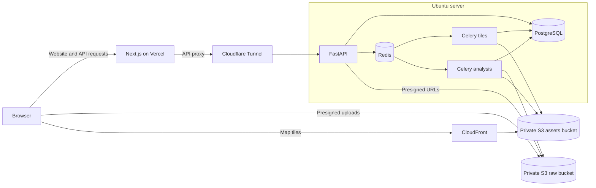
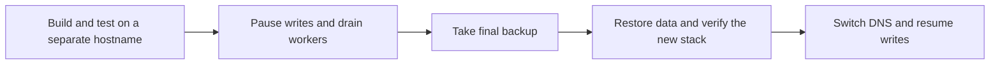

# GravelRoad Iowa administrator handoff

**Taking over the current server?** Start with the access checklist, then use the [deployment map](deployment.md) and [operations guide](operations.md) to verify the running system.

**Setting up a new server?** Follow steps 1–9 in order. If you are moving production data, follow the [migration steps](#move-an-existing-installation) before starting the new API or workers.

## Access checklist

- [ ] GitHub repository and deployment branch or commit.
- [ ] Server SSH and sudo, plus ownership of the Vercel project, Cloudflare zone and tunnel, and AWS resources.
- [ ] Backend environment values through the organization’s secret store and frontend settings in Vercel.
- [ ] PostgreSQL backup, both application S3 buckets, and read access to the private S3 bucket holding the two dust model files. Get the expected SHA-256 checksums and class labels from the outgoing admin.



## 1. Prepare Ubuntu and clone the repository

Use Ubuntu 24.04 and a dedicated Linux account. The examples use `graveladmin` and `/home/graveladmin/GravelRoad_Iowa`. Substitute your account and absolute path throughout. Run system changes with sudo and application commands as the application account.

```bash
sudo apt update
sudo apt install -y software-properties-common
sudo add-apt-repository -y universe
sudo apt update
sudo apt install -y \
  git curl ca-certificates gnupg unzip build-essential pkg-config \
  python3.12 python3.12-dev python3.12-venv \
  postgresql-16 postgresql-client-16 redis-server \
  gdal-bin libgdal-dev libproj-dev proj-data proj-bin \
  libgeos-dev libpq-dev \
  libpango-1.0-0 libpangoft2-1.0-0 libharfbuzz-subset0 \
  libffi-dev shared-mime-info fonts-dejavu-core \
  libnss3 libatk1.0-0 libatk-bridge2.0-0 libcups2 \
  libdrm2 libxkbcommon0 libxcomposite1 libxdamage1 libxfixes3 \
  libxrandr2 libgbm1 libasound2t64
```

Check `python3.12 --version` and `gdal-config --version`. The backend lockfile expects Python 3.12 and GDAL 3.8.4. Check free space on the project disk and `/tmp` for dependencies, raster processing, and reports.

If the application account is new, create it first. Use your administrator session for the remaining sudo commands.

```bash
sudo adduser graveladmin
sudo -iu graveladmin
```

```bash
cd /home/graveladmin
git clone https://github.com/Kunle-xy/Gravel_Road_Monitoring_WebAPP.git GravelRoad_Iowa
cd GravelRoad_Iowa
git switch main
git rev-parse HEAD
```

Install [uv](https://docs.astral.sh/uv/getting-started/installation/) under the application account and confirm `uv --version` works.

## 2. Set up PostgreSQL and Redis

1. Start PostgreSQL and open its console.

   ```bash
   sudo systemctl enable --now postgresql
   sudo -u postgres psql
   ```

2. Create the app role and database. Enter a new random hex password at the prompt and save it for `DATABASE_URL`.

   ```sql
   CREATE ROLE gravel_app LOGIN;
   \password gravel_app
   CREATE DATABASE gravel_road_app OWNER gravel_app;
   \q
   ```

   Keep PostgreSQL bound to localhost. Verify the login with `psql -h 127.0.0.1 -U gravel_app -d gravel_road_app -W`.

3. Open `/etc/redis/redis.conf` with `sudoedit` and update the existing settings. Save the new Redis password for all three Redis-related settings in step 4.

   ```conf
   bind 127.0.0.1 ::1
   protected-mode yes
   requirepass REPLACE_REDIS_HEX_PASSWORD
   appendonly yes
   maxmemory-policy noeviction
   ```

4. Start Redis and verify that it replies `PONG`.

   ```bash
   sudo systemctl enable --now redis-server
   sudo systemctl restart redis-server
   redis-cli --askpass -h 127.0.0.1 ping
   ```

## 3. Set up S3 and CloudFront

1. Create two buckets in the same AWS Region. Start with names like `gravel-road-raw-file-ORG` and `gravel-road-app-file-ORG`. Replace `ORG` with a lowercase suffix that makes each name globally unique. Enable Block Public Access, bucket-owner-enforced ownership, and default encryption on both. Add a lifecycle rule to abort incomplete multipart uploads.
2. Add CORS under **Permissions → Cross-origin resource sharing** on both buckets. Replace the example domain with the exact frontend origin, without a trailing slash. Keep the localhost origin if you need local development. The browser needs the exposed `ETag` for multipart uploads.

   ```json
   [
     {
       "AllowedOrigins": [
         "https://roads.example.org",
         "http://localhost:3000"
       ],
       "AllowedMethods": ["GET", "HEAD", "PUT", "POST", "DELETE"],
       "AllowedHeaders": ["*"],
       "ExposeHeaders": ["ETag", "Content-Length", "Content-Range", "Accept-Ranges"],
       "MaxAgeSeconds": 3600
     }
   ]
   ```

3. Create a dedicated AWS runtime identity, for example `gravel-road-app`. Scope its policy to the two buckets and their objects. Replace both bucket names below and save the runtime credentials in your secret store.

   ```json
   {
     "Version": "2012-10-17",
     "Statement": [
       {
         "Sid": "ListApplicationBuckets",
         "Effect": "Allow",
         "Action": ["s3:ListBucket", "s3:GetBucketLocation", "s3:ListBucketMultipartUploads"],
         "Resource": [
           "arn:aws:s3:::replace-with-your-raw-bucket",
           "arn:aws:s3:::replace-with-your-assets-bucket"
         ]
       },
       {
         "Sid": "ManageApplicationObjects",
         "Effect": "Allow",
         "Action": [
           "s3:GetObject", "s3:PutObject", "s3:DeleteObject",
           "s3:AbortMultipartUpload", "s3:ListMultipartUploadParts"
         ],
         "Resource": [
           "arn:aws:s3:::replace-with-your-raw-bucket/*",
           "arn:aws:s3:::replace-with-your-assets-bucket/*"
         ]
       }
     ]
   }
   ```

4. Create a CloudFront distribution using the assets bucket’s S3 REST origin. Choose Origin Access Control (OAC) with request signing, redirect HTTP to HTTPS, allow GET and HEAD, and leave the origin path blank. Configure CORS response headers for the frontend origin. Apply the OAC bucket policy AWS provides to the assets bucket and wait for the distribution to deploy.
5. Record the distribution hostname for step 4, such as `dexample123.cloudfront.net`. Treat CloudFront URLs as shareable links. The app serves them without signed viewer URLs or cookies.

## 4. Create the environment files

Open [`FastAPI/.env.example`](../FastAPI/.env.example) for the backend settings and [`webapp/.env.example`](../webapp/.env.example) for the frontend setting. Copy the backend template into the directory where FastAPI and both workers run.

```bash
cd /home/graveladmin/GravelRoad_Iowa/FastAPI
umask 077
cp -n .env.example .env
chmod 600 .env
nano .env
```

| Setting | What to enter |
| --- | --- |
| `DATABASE_URL` | The database role, password, and database name from step 2. URL-encode the password if it contains reserved characters. |
| `SECRET_KEY` | Generate a new value with `python3.12 -c 'import secrets; print(secrets.token_hex(32))'`. Reuse the transferred key if existing sessions must survive a migration. |
| `AWS_ACCESS_KEY_ID`, `AWS_SECRET_ACCESS_KEY`, `AWS_REGION` | Runtime credentials and Region from step 3. |
| `S3_BUCKET_RAW`, `S3_BUCKET_NAME` | The raw and assets bucket names, respectively. |
| `AWS_CLOUDFRONT_DOMAIN` | The distribution hostname only. |
| `FRONTEND_URL` | The exact public HTTPS frontend origin. Use `http://localhost:3000` for a local-only setup. |
| `REDIS_PASSWORD`, `CELERY_BROKER_URL`, `CELERY_RESULT_BACKEND` | Set the same Redis password in all three. Keep broker database `/0` and result database `/1`. |

Leave the other defaults in the template. Replace every placeholder before starting the app. Keep `.env` as plain `KEY=value` entries and store production values outside Git.

## 5. Install dependencies and dust models

From `FastAPI/`, sync the locked Python environment and install Chrome for static report exports.

```bash
cd /home/graveladmin/GravelRoad_Iowa/FastAPI
uv venv --python /usr/bin/python3.12
uv sync --locked
```

```bash
.venv/bin/plotly_get_chrome -y
.venv/bin/python -c 'import plotly.graph_objects as go; data=go.Figure(go.Scatter(y=[1,3,2])).to_image(format="png"); assert data.startswith(bytes([137,80,78,71])); print("Report PNG rendering OK")'
```

If GDAL fails to build, confirm `gdal-config --version` first. For a NumPy or build isolation error with GDAL 3.8.4, run:

```bash
uv pip install 'numpy>=2.4.3' setuptools wheel
uv sync --locked --no-build-isolation-package gdal
```

Ask the GravelRoad team for the private S3 bucket name, the folder and filenames for both models, and read access. From `FastAPI/`, use the AWS CLI and replace `MODEL_BUCKET`, `MODEL_FOLDER`, `DETECTOR_FILENAME`, and `CLASSIFIER_FILENAME` with the details the team provides. If the files are at the bucket root, remove `MODEL_FOLDER/` from both URLs.

```bash
model_dir=$(mktemp -d)
aws s3 cp "s3://MODEL_BUCKET/MODEL_FOLDER/DETECTOR_FILENAME" "$model_dir/yolo26l.pt"
aws s3 cp "s3://MODEL_BUCKET/MODEL_FOLDER/CLASSIFIER_FILENAME" "$model_dir/best_model_final.pt"
sha256sum "$model_dir/yolo26l.pt" "$model_dir/best_model_final.pt"
```

Compare both hashes with the expected checksums from the handoff. If both match, run these commands in the same shell. The app expects these destination paths even if the S3 filenames differ.

```bash
install -m 600 "$model_dir/yolo26l.pt" ./yolo26l.pt
install -m 600 "$model_dir/best_model_final.pt" ./app/workers/dust/best_model_final.pt
```

Confirm expected predictions on known labeled clips before enabling dust analysis for users.

If the model files are unavailable, record dust analysis as unavailable when handing over the deployment.

## 6. Initialize the database and approve a user

For a fresh database, run this from `FastAPI/`. For a migration, restore and review the schema first.

```bash
.venv/bin/python - <<'PY'
from app.database import Base, engine
import app.models
Base.metadata.create_all(bind=engine)
print("Application tables created")
PY
```

Replace the example address with the first user’s real address. Ask them to register on the website using that address. The allowlist grants application access.

```bash
.venv/bin/python manage_approved.py add admin@example.org --note "Incoming administrator"
.venv/bin/python manage_approved.py list
```

## 7. Install the systemd services

Use the same unit names as the current deployment. Use `sudoedit /etc/systemd/system/UNIT` for each file below, replacing `UNIT` with its filename. Update `User`, `Group`, and every absolute path if your checkout differs.

| Unit | Purpose |
| --- | --- |
| `fastapi.service` | API on `127.0.0.1:8000` |
| `celery-tiles.service` | Tile jobs on the `tiles` queue |
| `celery-analysis.service` | Analysis jobs on the `celery` queue |
| `cloudflared.service` | Public API tunnel installed in step 8 |
| `postgresql.service`, `redis-server.service` | Database and Redis units installed by Ubuntu |

### `fastapi.service`

```ini
[Unit]
Description=GravelRoad FastAPI
Wants=network-online.target
After=network-online.target postgresql.service redis-server.service

[Service]
Type=simple
User=graveladmin
Group=graveladmin
WorkingDirectory=/home/graveladmin/GravelRoad_Iowa/FastAPI
EnvironmentFile=/home/graveladmin/GravelRoad_Iowa/FastAPI/.env
Environment="PATH=/home/graveladmin/GravelRoad_Iowa/FastAPI/.venv/bin:/usr/local/sbin:/usr/local/bin:/usr/sbin:/usr/bin:/sbin:/bin"
Environment=PYTHONUNBUFFERED=1
ExecStart=/home/graveladmin/GravelRoad_Iowa/FastAPI/.venv/bin/gunicorn app.main:app -k uvicorn.workers.UvicornWorker --bind 127.0.0.1:8000 --workers 2 --timeout 300 --max-requests 100 --max-requests-jitter 20
Restart=always
RestartSec=5
UMask=0077

[Install]
WantedBy=multi-user.target
```

### `celery-tiles.service`

```ini
[Unit]
Description=GravelRoad tile worker
Wants=network-online.target
After=network-online.target postgresql.service redis-server.service

[Service]
Type=simple
User=graveladmin
Group=graveladmin
WorkingDirectory=/home/graveladmin/GravelRoad_Iowa/FastAPI
EnvironmentFile=/home/graveladmin/GravelRoad_Iowa/FastAPI/.env
Environment="PATH=/home/graveladmin/GravelRoad_Iowa/FastAPI/.venv/bin:/usr/local/sbin:/usr/local/bin:/usr/sbin:/usr/bin:/sbin:/bin"
Environment=PYTHONUNBUFFERED=1
ExecStart=/home/graveladmin/GravelRoad_Iowa/FastAPI/.venv/bin/celery -A app.celery_app worker --loglevel=INFO --queues=tiles --concurrency=1 --hostname=tiles@%%h
Restart=always
RestartSec=5
TimeoutStopSec=infinity
UMask=0077

[Install]
WantedBy=multi-user.target
```

### `celery-analysis.service`

```ini
[Unit]
Description=GravelRoad analysis worker
Wants=network-online.target
After=network-online.target postgresql.service redis-server.service

[Service]
Type=simple
User=graveladmin
Group=graveladmin
WorkingDirectory=/home/graveladmin/GravelRoad_Iowa/FastAPI
EnvironmentFile=/home/graveladmin/GravelRoad_Iowa/FastAPI/.env
Environment="PATH=/home/graveladmin/GravelRoad_Iowa/FastAPI/.venv/bin:/usr/local/sbin:/usr/local/bin:/usr/sbin:/usr/bin:/sbin:/bin"
Environment=PYTHONUNBUFFERED=1
ExecStart=/home/graveladmin/GravelRoad_Iowa/FastAPI/.venv/bin/celery -A app.celery_app worker --loglevel=INFO --queues=celery --concurrency=1 --hostname=analysis@%%h
Restart=always
RestartSec=5
TimeoutStopSec=infinity
UMask=0077

[Install]
WantedBy=multi-user.target
```

Keep `%%h` in the unit files so Celery receives its hostname placeholder. Start with one process per worker. Before enabling the dedicated workers on an existing host, check for a legacy `celery-worker.service`. Drain its jobs and disable it to avoid two worker versions consuming the same queue.

```bash
sudo systemd-analyze verify /etc/systemd/system/fastapi.service /etc/systemd/system/celery-tiles.service /etc/systemd/system/celery-analysis.service
sudo systemctl daemon-reload
sudo systemctl enable --now fastapi celery-tiles celery-analysis
systemctl is-active fastapi celery-tiles celery-analysis
systemctl is-enabled fastapi celery-tiles celery-analysis
curl --fail http://127.0.0.1:8000/health
```

Expect all three services to be active and enabled and the local health endpoint to succeed.

## 8. Publish the API through Cloudflare

1. Install `cloudflared` using the [Cloudflare package instructions](https://pkg.cloudflare.com/index.html).
2. As the application account, authorize your zone and create a tunnel. Use `gravel-road` to match the current deployment, or `gravel-road-staging` for a parallel test. Use the name you pick in the DNS command below.

   ```bash
   cloudflared tunnel login
   cloudflared tunnel create gravel-road
   ```

3. Copy the tunnel credentials and create `/etc/cloudflared/config.yml`. Replace `REPLACE_TUNNEL_UUID` and the example API hostname. Use a test hostname until you are ready to move existing traffic.

   ```bash
   sudo install -d -m 700 /etc/cloudflared
   sudo install -m 600 /home/graveladmin/.cloudflared/REPLACE_TUNNEL_UUID.json /etc/cloudflared/REPLACE_TUNNEL_UUID.json
   sudoedit /etc/cloudflared/config.yml
   ```

   ```yaml
   tunnel: REPLACE_TUNNEL_UUID
   credentials-file: /etc/cloudflared/REPLACE_TUNNEL_UUID.json
   ingress:
     - hostname: api.gravel.example.org
       service: http://127.0.0.1:8000
     - service: http_status:404
   ```

4. Create the DNS route, install the service, and check the public health endpoint.

   ```bash
   cloudflared tunnel route dns gravel-road api.gravel.example.org
   sudo cloudflared --config /etc/cloudflared/config.yml tunnel ingress validate
   sudo cloudflared --config /etc/cloudflared/config.yml service install
   sudo systemctl enable --now cloudflared
   systemctl is-active cloudflared
   curl --fail https://api.gravel.example.org/health
   ```

## 9. Deploy the frontend and verify the app

1. In Vercel, import the GitHub repository, choose **Next.js**, set the Root Directory to `webapp`, and set the production branch to `main`.
2. Use [`webapp/.env.example`](../webapp/.env.example) to find the variable name. Set `NEXT_PUBLIC_API_URL` to the public tunnel URL, such as `https://api.gravel.example.org`. Deploy after setting it so Next.js builds the API rewrite with the correct URL.
3. Confirm that `FRONTEND_URL` and both S3 CORS configurations use the final frontend origin. If you change the backend `.env`, restart FastAPI and both workers after active jobs finish.
4. Register with the approved address, sign in, upload a TIFF, and confirm that the map loads its generated tiles. Try a large multipart upload and submit an analysis. Open the exported report and check its images. If dust is enabled, verify it with a known clip.

For a local frontend, run these commands from `webapp/` and open `http://localhost:3000`. The template points to the local API on port 8000.

```bash
cp -n .env.example .env.local
npm ci
npm run dev
```

## Move an existing installation

1. Record the old commit, database version, domains, bucket names, session-signing key, and worker settings. Build and test the replacement on a separate hostname.
2. Take a practice backup and restore. At cutover, pause writes and drain workers before taking the final backup. Run the dump on the old server and transfer it securely with its checksum.

   ```bash
   umask 077
   pg_dump -h 127.0.0.1 -U OLD_DATABASE_ROLE -d OLD_DATABASE_NAME -W \
     --format=custom --no-owner --no-acl --file=gravel-transfer.dump
   ```

3. Restore into an empty target database before starting FastAPI. Compare the restored schema against the current models. Review historical SQL patches individually if changes are needed. `create_all()` only creates missing tables.

   ```bash
   pg_restore -h 127.0.0.1 -U gravel_app -d gravel_road_app -W \
     --no-owner --no-acl --exit-on-error /secure/staging/gravel-transfer.dump
   ```

4. Transfer access to both existing S3 buckets or copy them and reconcile bucket names stored in database records. Check uploads, tiles, profile pictures, reports, and user access before switching traffic.
5. Point the API hostname and Vercel deployment to the new stack. Keep the old stack and backups available for rollback. Once the new stack accepts writes, reconcile any new data before switching back.



## Operate and back up the app

- Check service health with `systemctl status fastapi celery-tiles celery-analysis cloudflared`. View recent logs with `sudo journalctl -u SERVICE -n 80 --no-pager`, substituting the unit name.
- Before updating, record the running commit and drain active jobs. Pull the reviewed commit, run `uv sync --locked` from `FastAPI/`, apply any reviewed schema changes, then restart FastAPI and both workers. Repeat the checks in step 9.
- Schedule PostgreSQL backups and protect both S3 buckets, the model files, and service configuration. Store database backups encrypted off-server and environment values and tunnel credentials in a secret store. Test recovery in an isolated environment.
- For a stuck job, check Redis and the two worker logs. For a failed upload, check the exact frontend origin and exposed `ETag` in both S3 CORS policies. For blank tiles, check CloudFront’s OAC policy and whether the tile worker wrote objects to the assets bucket.

See the [operations guide](operations.md) for service commands and troubleshooting.
